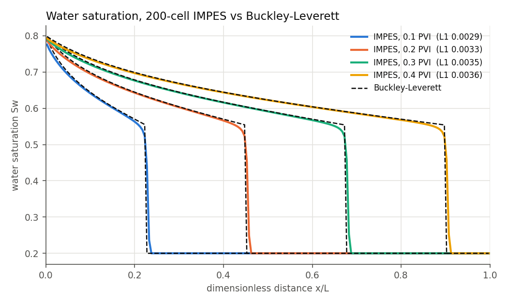
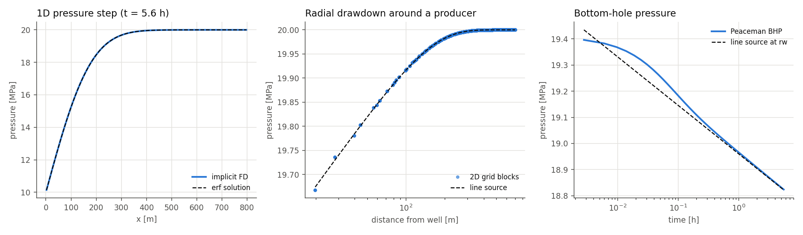
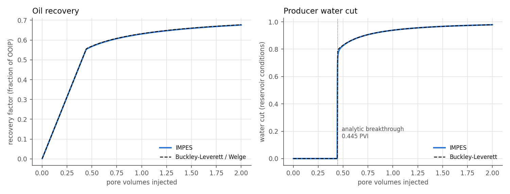
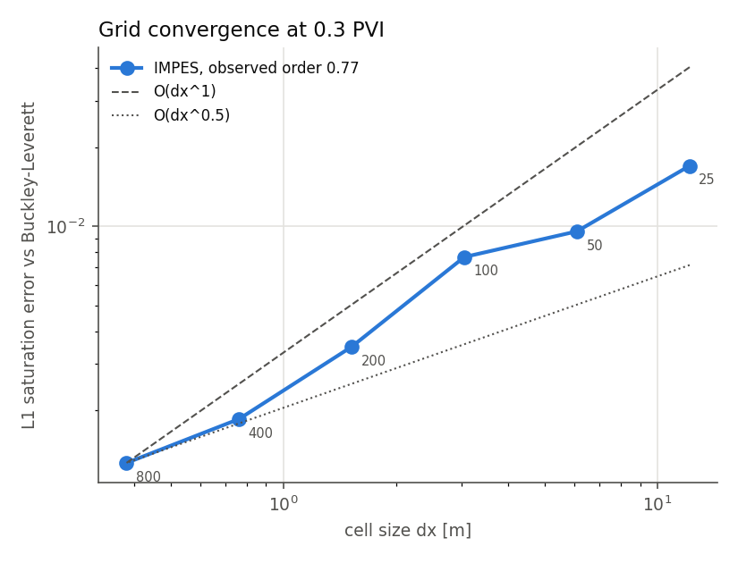
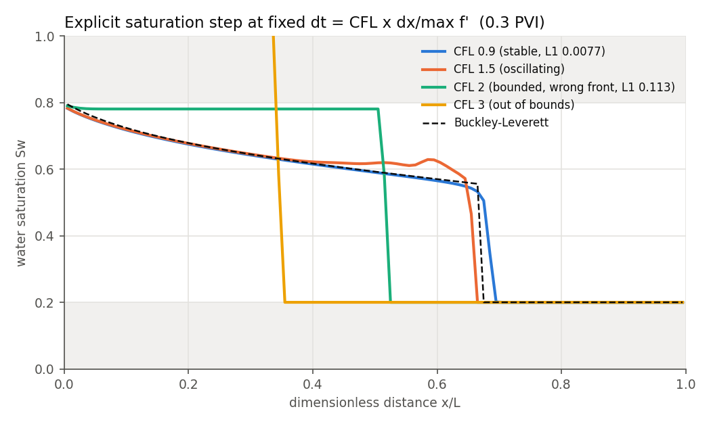
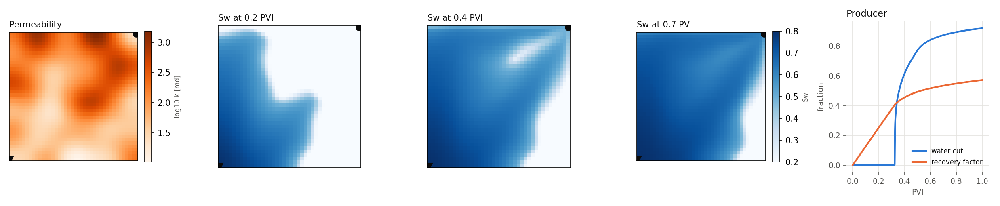
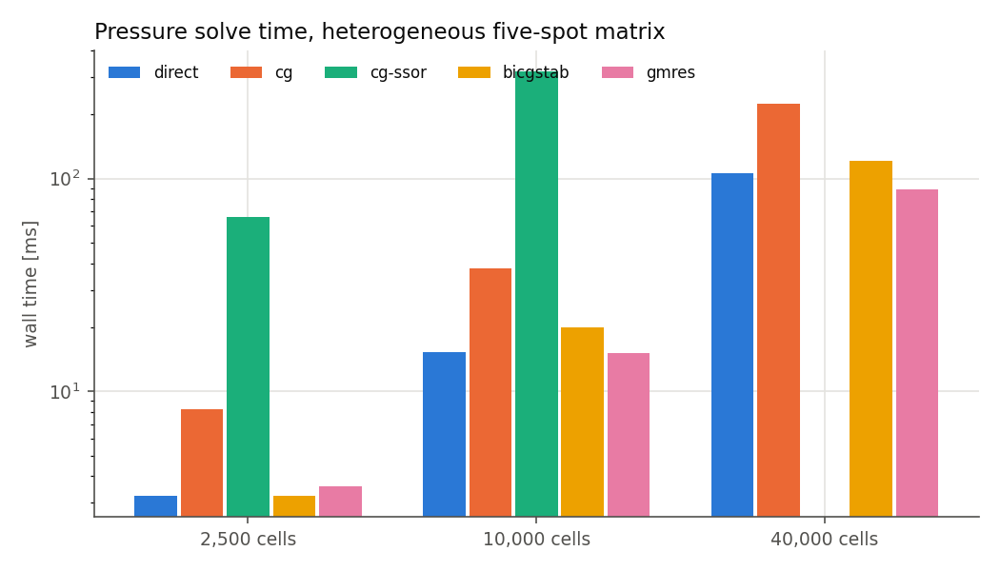

# ressim: 1D/2D finite-difference reservoir simulator

A small reservoir simulator written from scratch in Python (numpy + scipy.sparse). It is built in two layers:

1. **Single-phase, slightly compressible flow.** Two-point flux finite differences in space and backward Euler in time, so every step is one sparse linear solve. It supports heterogeneous permeability, constant-pressure boundaries, gravity, and rate- or BHP-controlled wells with Peaceman's well index.
2. **Two-phase water/oil flow with IMPES** (implicit pressure, explicit saturation). An implicit total-flux pressure equation is followed by an explicit, first-order upwind saturation update. Corey relative permeability, Brooks-Corey capillary pressure and gravity are included, and each phase is upwinded on its own potential. The time step adapts to the CFL and capillary-diffusion limits.

Each layer is checked against analytical solutions. The main check runs 1D waterfloods against the **Buckley-Leverett** shock/rarefaction solution and Welge's recovery equation.



## Install

```bash
pip install -e ".[dev]"
pytest            # 79 unit tests + doctests
```

Requires Python 3.10+, numpy, scipy and matplotlib.

## Quick start

```bash
# analytical Buckley-Leverett: front saturation, breakthrough, recovery table
ressim buckley-leverett --mu-o 5 --mu-w 1 --nw 2 --no 2

# 1D IMPES waterflood compared with Buckley-Leverett (+ figures)
ressim waterflood --nx 200 --pvi 2 --plot out/

# same flood with capillary pressure (5 psi entry pressure, 1 darcy rock)
ressim waterflood --nx 100 --perm 1000 --pc-entry 5

# 2D quarter five-spot on a correlated log-normal permeability field
ressim five-spot --n 40 --pvi 1 --plot five_spot.png

# re-run every validation study and write all figures
ressim validate --out validation_output
```

Python API (see [examples/api_example.py](examples/api_example.py)):

```python
grid = Grid(nx=200, lx=1000 * FT, ly=100 * FT, thickness=30 * FT, perm=100 * MILLIDARCY, poro=0.2)
wells = [Well("INJ", 0, "rate", 100 * STB_PER_DAY),
         Well("PROD", grid.n - 1, "bhp", 3000 * PSI, wi=face_wi(grid, "xmax"))]
sim = IMPESSimulator(grid, TwoPhaseFluid(1 * CP, 5 * CP), CoreyRelPerm(), 0.2, wells, p_init=3000 * PSI)
res = sim.run(pvi_end=1.0, report_pvi=(0.3,))
```

All internal calculations use SI units. [`ressim.units`](ressim/units.py) converts from field units (md, psi, cp, ft, STB/day).

## How it works

### Discretisation

Cells are block-centred on a uniform Cartesian grid; 1D is simply `ny = 1`. The flux between neighbouring cells *a* and *b* is

```
F = T_ab * lambda * (Phi_a - Phi_b),     T_ab = A / dx * 2 k_a k_b / (k_a + k_b)
```

Here `T_ab` is the harmonic-average transmissibility, which gives the exact effective permeability for layers in series. Constant-pressure faces use the half-cell transmissibility `2kA/dx`.

**Single phase** ([single_phase.py](ressim/single_phase.py)):
`phi ct V (p^{n+1} - p^n)/dt + sum T/mu (p_a - p_b) = q`. This is a symmetric M-matrix (weighted graph Laplacian + positive diagonal). Backward Euler is unconditionally stable and first-order in time, and a test confirms the convergence rate.

**Wells** ([wells.py](ressim/wells.py)): `q = WI * lambda * (p_bhp - p_block)` with Peaceman's `WI = 2 pi sqrt(kx ky) h / (ln(r0/rw) + s)` and the anisotropic equivalent radius `r0`.

**IMPES** ([impes.py](ressim/impes.py)). Each step:

1. **Pressure, implicit.** With saturations frozen, sum the water and oil equations for incompressible fluids:
   `sum T (lam_w + lam_o)_up (p_a - p_b) = q_t + sum T [lam_w (Pc_a - Pc_b) + (lam_w rho_w + lam_o rho_o) g (z_a - z_b)]`.
   Face mobilities are taken from each phase's upstream cell based on its potential `Phi_w = p - Pc - rho_w g z` and `Phi_o = p - rho_o g z`, so counter-current flow from gravity or imbibition is handled.
2. **Saturation, explicit.** `phi V (S^{n+1} - S^n)/dt = q_w - sum F_w`. The update is conservative, so water mass balance closes to round-off (about 1e-15) at every step.
3. **Time step.**
   `dt = cfl * min_i phi V_i / (Q_out,i * max f' + sum_faces D_face + gravity term)`.
   The first term is the hyperbolic CFL limit. `D_face = T lam_w lam_o / lam_t |dPc/dS|` is the explicit-diffusion limit from capillary pressure. Because Brooks-Corey Pc is steep near Swc, `|dPc/dS|` is measured as the secant across each face.

### Buckley-Leverett ([buckley_leverett.py](ressim/buckley_leverett.py))

The front saturation comes from the Welge tangent. Numerically, it is the maximiser of the secant slope `(f(S) - f(Swi)) / (S - Swi)`. If several saturations tie (a straight segment of `f`), the largest wins, so piston-like displacement comes out right. Behind the shock, `x_D = t_D f'(S)` is inverted on the monotone branch of `f'`. After breakthrough, the Welge equation `S_avg = S2 + (1 - f(S2))/f'(S2)` gives recovery. Initial mobile water (`Swi > Swc`) is supported.

### Linear solvers ([linalg.py](ressim/linalg.py))

The pressure matrices are SPD, so they can use CG. They are first scaled symmetrically by their diagonal, because SI transmissibilities are about 1e-15 and vary over orders of magnitude. The available solvers are:

| method | notes |
|---|---|
| `direct` | SuperLU. The default; fastest at these sizes. |
| `cg` | Jacobi-preconditioned CG |
| `cg-ssor` | CG with a symmetric Gauss-Seidel preconditioner. ILU is not symmetric, so it cannot be used with CG. |
| `bicgstab`, `gmres` | ILU-preconditioned. The ILU uses a symmetric minimum-degree ordering without pivoting, because SciPy's default COLAMD + partial pivoting gave unstable factors on heterogeneous Laplacians and BiCGSTAB broke down. |

## Validation

All numbers below come from `ressim validate` (full output in [examples/validation_report.txt](examples/validation_report.txt)). The reference flood is 1000 ft × 100 ft × 30 ft of 100 md, 20% porosity rock. It has Swc = Sor = 0.2, Corey exponents 2/2 (krw0 = 0.3, kro0 = 0.8), and 1 cp water displacing 5 cp oil, injected at 1 PV per 500 days.

### Single phase vs analytical

| check | result |
|---|---|
| 1D pressure step vs `erf` solution (400 cells) | max error 0.075% of the step |
| 2D drawdown (101×101) vs line source, 60–300 m from the well | max error 0.09% of the drawdown |
| Peaceman BHP vs line source evaluated at `rw` | 2730.1 vs 2729.9 psi (0.15% of drawdown) |
| Darcy flow, harmonic series layers, hydrostatic column | exact to round-off (unit tests) |



Peaceman's index assumes steady radial flow, so the block-based BHP deviates during the first minutes. It converges to the line-source wellbore pressure once the transient has moved a few cells beyond the well block.

### IMPES vs Buckley-Leverett (200 cells)

| quantity | IMPES | analytical |
|---|---|---|
| L1 saturation error at 0.1 / 0.2 / 0.3 / 0.4 PVI | 0.0029 / 0.0033 / 0.0035 / 0.0036 | |
| breakthrough (water cut > 1%) | 0.442 PVI | 0.445 PVI |
| max recovery-factor error, 0–2 PVI | 0.0025 | |
| water mass balance | 5.6e-15 | |



The simulated front is slightly smeared by first-order upwinding (numerical diffusion), so a little water arrives just before the analytical breakthrough.

### Grid convergence

| nx | 25 | 50 | 100 | 200 | 400 | 800 |
|---|---|---|---|---|---|---|
| L1 error at 0.3 PVI | 0.0170 | 0.0096 | 0.0077 | 0.0035 | 0.0019 | 0.0013 |

The observed order is **0.77**. A first-order scheme reaches O(dx) only for smooth solutions. Across a shock, the smeared region spans a fixed number of cells, so the L1 error falls between O(dx^0.5) and O(dx).



### Numerical stability of the explicit saturation step

Running with a *fixed* `dt = CFL × dx / max f'` shows where the explicit scheme breaks down:

| CFL | bounded | monotone | L1 |
|---|---|---|---|
| 0.5 – 1.25 | yes | yes | 0.005 – 0.011 |
| 1.5 | yes | **no**: oscillation behind the front | 0.013 |
| 2.0 | yes | yes, but the front is in the wrong place | 0.113 |
| 3.0 | **no**: Sw leaves [Swc, 1−Sor] | no | 0.252 |

The textbook limit `CFL ≤ 1` uses the largest `f'` over the whole saturation range (3.44 here). The entropy solution jumps over the steepest part of `f` inside the shock, so the fastest speed actually present is the shock speed (2.25). The real limit is therefore about `max f' / shock speed ≈ 1.5`, which matches where oscillations start. The simulator keeps the conservative bound with a 0.9 safety factor.



This restriction is the main weakness of IMPES. In the 2D five-spot, all of the well's rate passes through one well block, so that cell sets the step for the whole grid. The heterogeneous 40×40 case needs about 6000 steps to inject 1 PV. Capillary pressure tightens the limit further, to `dt ~ dx²/D` on fine grids. Both effects are why production simulators move to sequential-implicit or fully implicit formulations.

### 2D heterogeneous quarter five-spot



The permeability field is a log-normal field (σ_lnk = 1) smoothed with a Gaussian kernel. Water channels through the high-permeability streaks and breaks through at 0.32 PVI, earlier than the 1D Buckley-Leverett 0.45 PVI, because areal sweep is incomplete.

### Linear solver benchmark

These are the pressure matrices for a heterogeneous five-spot (σ_lnk = 1.5), solved to a relative residual of 1e-8:

| cells | direct | CG (Jacobi) | BiCGSTAB-ILU | GMRES-ILU |
|---|---|---|---|---|
| 2,500 | 3 ms | 310 it, 8 ms | 2 it, 3 ms | 4 it, 4 ms |
| 10,000 | 15 ms | 614 it, 38 ms | 10 it, 20 ms | 5 it, 15 ms |
| 40,000 | 106 ms | 1215 it, 225 ms | 17 it, 122 ms | 7 it, 89 ms |

Jacobi-CG iteration counts roughly double each time the grid is refined by 2× per side. That is the expected `sqrt(cond) ~ 1/h` growth. ILU removes most of it. At these sizes a sparse direct solve is still competitive, but GMRES-ILU starts winning at 40k cells.



## Layout

```
ressim/
  grid.py             Cartesian grid, harmonic transmissibilities, log-normal fields
  linalg.py           sparse assembly, direct / CG / SSOR-CG / ILU-BiCGSTAB / ILU-GMRES
  single_phase.py     implicit slightly compressible solver, erf solution
  wells.py            Peaceman WI, rate/BHP wells, line-source solution
  relperm.py          Corey kr, Brooks-Corey Pc, fractional flow
  buckley_leverett.py Welge tangent, profiles, breakthrough, recovery
  impes.py            two-phase IMPES with Pc, gravity and CFL control
  validation.py       all analytical comparisons
  plots.py, cli.py
tests/                one file per module
examples/             API example, validation report, figures
```

## Limitations

- Incompressible two-phase flow (the single-phase solver is compressible). A two-phase run needs a BHP well or zero net rate to fix the pressure level.
- First-order upwinding in space and time. Fronts smear over several cells; a MUSCL/TVD reconstruction would sharpen them.
- Uniform Cartesian grids with vertical wells only. There are no corner-point grids or non-neighbour connections.
- Explicit saturation, so the step is CFL-limited near wells and with strong capillarity (see above).
